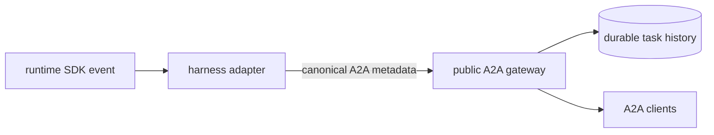

# A2A Metadata

A2A metadata extends the protocol; it does not replace it. Kagent uses native
A2A fields whenever they express the required behavior and adds metadata only
for semantics missing from the pinned A2A version.

Public kagent-owned keys use the `kagent.dev/a2a/<name>` namespace. Each key has
one meaning, an explicit owner, and a defined carrier.

## Ownership

Runtime adapters own knowledge of their SDK. They translate the small set of
runtime semantics that Kagent exposes into canonical metadata and discard the
remaining SDK metadata. A new runtime must emit the same public contract; the
gateway does not learn or translate each runtime's metadata dialect.

The gateway owns routing, trust-boundary checks, persistence, and the metadata
derived from those responsibilities. It removes caller-supplied values for
gateway-owned fields before setting them itself. Otherwise, it relays canonical
runtime metadata and preserves application or negotiated extension metadata.

Consumers read only native A2A fields and the canonical Kagent keys. They do not
interpret runtime-specific metadata.

## Current contract

| Key                                   | Carrier             | Meaning                                                                                              |
| ------------------------------------- | ------------------- | ---------------------------------------------------------------------------------------------------- |
| `kagent.dev/a2a/timeline-position`    | message or artifact | Temporary RFC 3339 timestamp used to order task history until the upstream A2A timeline is available |
| `kagent.dev/a2a/task-created-at`      | task                | Durable task creation time used by task projections                                                  |
| `kagent.dev/a2a/part-type`            | data part           | Semantic data kind, including function calls and function results                                    |
| `kagent.dev/a2a/usage`                | task event          | Model usage reported by runtimes that support it                                                     |
| `kagent.dev/a2a/output-schema-sha256` | result part         | Binds a structured result to the compiled output schema                                              |

Timeline positions are written at the boundary producing an item: the gateway
for inbound messages and runtime adapters for outbound messages and artifacts.
The gateway remains responsible for applying the resulting durable order.

## Per-turn model and effort override

| Key                      | Carrier | Meaning                                                      |
| ------------------------ | ------- | ------------------------------------------------------------ |
| `kagent.dev/model`       | message | Optional per-turn override of the harness's configured model |
| `kagent.dev/effort`      | message | Optional per-turn override of the harness's reasoning effort |

Unlike the gateway-owned keys above, these two are caller-supplied input, not
state the gateway derives, so they live outside the `kagent.dev/a2a/`
namespace and `SanitizeCallerRequest` never strips them. A caller (Mainloop's
sticky `/model` and `/effort` session settings) sets them on the message that
starts a turn; a change applies from that turn onward and never interrupts a
turn already running.

The shared A2A executor (`go/harness/runtime/a2a`) reads both keys while
building a `runtime.Turn`, validates them, and rejects an invalid value with
`ErrInvalidRequest` before the turn starts — never by failing a task already
`WORKING`. `Model` must match `[A-Za-z0-9._:/-]` within a bounded length;
`Effort` must be one of the harness's configured levels (passed to
`runtimea2a.New`; Claude accepts `low`, `medium`, `high`, `xhigh`, `max`,
Codex accepts `minimal`, `low`, `medium`, `high`). An absent or empty value
means the harness's configured default applies. Both fields are optional and
additive: a turn that omits them, and every existing caller, is unaffected.

The Claude driver passes a non-empty override as `--model`/`--effort` on the
per-turn `claude -p --resume` invocation. The Codex driver passes a non-empty
override as the `model`/`effort` fields on the App Server's `turn/start` call.
Neither driver's override selects or starts a new native session: Claude
always resumes the Actor's one native conversation through `--resume`, and
Codex always resumes or continues the one native thread through
`thread/resume`/the existing process; only the turn's own request changes.

## Other metadata

Versioned A2A extensions, such as the human-in-the-loop extension, keep their
negotiated URI as the metadata key. Private gateway-to-runtime continuation
state uses an internal URI and is consumed before the message can enter public
history.

Unknown application metadata is currently preserved. A future gateway
allowlist can narrow what crosses the public boundary without changing the
ownership rule: adapters translate runtime internals, while the gateway
enforces the public contract.
